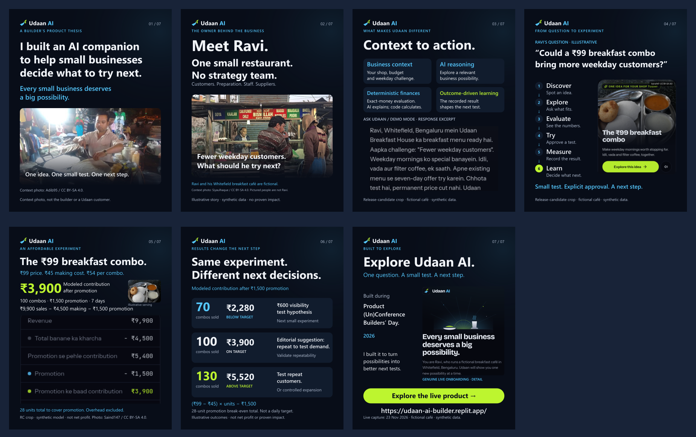

# Udaan AI — LinkedIn launch kit

**Every small business deserves a big possibility.**

Seven-slide, mobile-first launch story in Udaan's deep navy, cyan and lime identity. This is marketing artwork, not an application rebuild or deployment.

**Publication revision:** a first-person builder hook and personal caption; a four-part product thesis (business context, AI reasoning, deterministic financial evaluation, outcome-driven learning); Ravi's illustrative combo question next to the journey; larger genuine screenshot excerpts; and a stronger live invitation with a single-line URL. This revision reuses the saved evidence — no new app session or server-state interaction was needed.



## Ready-to-use deliverables

| File / folder | Purpose |
| --- | --- |
| [udaan-linkedin-carousel.pdf](udaan-linkedin-carousel.pdf) | Seven-page LinkedIn document carousel; 4:5 pages; live product link on the invitation page |
| [slides/](slides/) | Seven individually exported **2160 × 2700** PNGs; base composition 1080 × 1350 |
| [source/](source/) | Eight editable, self-contained SVGs, plus design/model/crop manifest |
| [linkedin-cover.png](linkedin-cover.png) | **2400 × 1254** feed/link cover; 1200 × 627 source. Not a profile-banner crop |
| [screenshots/](screenshots/) | Two live entry captures saved on 23 Nov 2026, four unaltered inherited workflow captures, ten exact pixel crops |
| [390px mobile proofs](previews/mobile-390/) / [320px mobile proofs](previews/mobile-320/) | All seven final slides at native mobile viewing sizes |
| [demo-storyboard.pdf](demo-storyboard.pdf) | Six-frame, **55-second** demonstration storyboard with narration and provenance |
| [demo-storyboard.md](demo-storyboard.md) | Editable timing, narration, shot plan and recording instructions |
| [linkedin-caption.md](linkedin-caption.md) | First-person product-building story, ready for review |
| [EVIDENCE.md](EVIDENCE.md) | Capture provenance, financial grounding and production/prototype boundaries |
| [CREDITS.md](CREDITS.md) | Image attribution, adaptation notices and share-alike licenses |
| [VALIDATION.md](VALIDATION.md) | Output checks and visual fix/reverification record |

### Publishing

Upload the PDF as a LinkedIn **document post**, not seven separate images. Use the caption draft; select slide 1 as the document cover. PNGs are suitable for alternate image posts or previews. The cover is designed for a feed/link preview; do not stretch it into a profile header.

Keep each slide's disclosures visible. In particular, do not crop away the fictional/model or release-candidate captions. Attribution is included on photographic slides and the cover; retain it when republishing.

The SVGs can be edited in Inkscape, Illustrator or another SVG editor. Text, cards and graphic elements remain separate editable objects; genuine photographs/screens are embedded raster imagery. **No PowerPoint or MP4 file is claimed.** The storyboard is not a recorded production walkthrough.

## Reproducible exports

Requirements: Node.js 20+, Python 3.10+, Segoe UI on Windows, dependencies below. The marketing tools are isolated; do not install at the repository root or start an application workflow.

```powershell
Set-Location marketing\linkedin-launch
npm.cmd ci --no-audit --no-fund
python -m pip install -r requirements.txt
npm.cmd run render
npm.cmd run validate
```

`render` reads the committed SVGs, rasterizes them at 2×, and makes the PDFs, contact sheet and 390px/320px mobile proofs. It preserves manual SVG edits. **`npm.cmd run author` regenerates and overwrites SVG sources**, using the existing `website\assets` files and committed live captures; only run it when intentionally revising the authored layout. Change `tools\author.mjs` for reproducible design changes.

On Windows Segoe UI/Segoe UI Semibold are used without redistributing font files. For other platforms, install a compatible font or explicitly change the SVG font family and recheck line wrapping. PDF/PNG exports do not require the reader to install fonts.

### Optional read-only recapture

```powershell
# Point to an existing Chromium installation, or install Chromium for Playwright.
$env:CHROMIUM_PATH = 'C:\path\to\chrome.exe'
npm.cmd run capture
```

Capture performs no clicks, no language changes, no chat/research/speech calls, no saves and no Demo-entry mutation. The frontend's normal GET requests may issue a visitor cookie and initialize its synthetic visitor session; no deliberate business-state mutation is sent. The current onboarding action uses a **server-side PATCH**, so downstream capture deliberately stops before it. Static service-worker setup is allowed; disabling it injects a real "Offline setup unavailable" warning, so that capture configuration is not used.

Recapture updates `screenshots\live\capture.json`. Do not run it if you need to preserve the launch capture date; all committed hashes refer to the saved captures. Deeper new screenshots require separate authorization for the synthetic server-state writes, or a pre-existing approved demo session. Do not inject fake API responses or reconstruct screens.

## Accuracy and boundaries

At ₹99 selling price and ₹45 variable making cost, a seven-day test with ₹1,500 promotion yields **₹2,280 / ₹3,900 / ₹5,520** at **70 / 100 / 130 units**. These are **modeled contributions after promotion**, not net profit. Promotion break-even is **28 total units**, not 28 each day, extra units, or full-business break-even.

Ravi, the café and business records are fictional. Pictured people are contextual photographs, not Ravi or customers. Next steps are hypotheses. The 70/130 recommendations are documented demo branches; the 100-unit next step is explicitly **editorial advice**, not a captured AI response.

The only independently captured deployed UI is onboarding, saved on 23 Nov 2026. Other screenshots are genuine inherited release-candidate evidence. The larger excerpts do not change any application text. Slide 4's owner question is explicitly illustrative editorial copy outside the screenshot, not a fabricated chat exchange. The four-part differentiation is the product thesis; the depicted Ask Udaan response remains labeled **Demo Mode**, not a new live-model call. Outcome-driven learning is retained results informing suggestions, not model retraining.

Sarvam remains **internal Voice Lab-only**, not integrated into the main production chat. No award status, endorsement, adoption or proven impact is asserted.

Only `marketing/linkedin-launch/` changes. No application, API, database, production setting or deployment workflow was edited, rebuilt or redeployed; no paid service was triggered. Repository visibility was observed as public and was not changed. The app enforced **`amit1858-udaan-linkedin-launch-kit`**, rather than the requested exact `feature/udaan-linkedin-launch-kit`.
